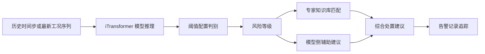

# 专家知识库资料搜集与规则整理

## 1. 建设目的

专家知识库用于把 SRU/Claus 硫回收装置的公开工艺知识、常见异常经验和当前模型推理结果连接起来，形成“模型预测 -> 风险判别 -> 专家规则命中 -> 处置建议”的闭环。

当前知识库已经整理为结构化 CSV：

- [expert_knowledge_base.csv](C:/Users/lenovo/Desktop/人工智能大赛/data/external/expert_knowledge_base.csv)

## 2. 资料来源类型

本轮整理主要参考以下公开资料类型：

- 环保与工艺基础资料：SRU/Claus 工艺流程、H2S/SO2 反应关系、尾气焚烧和排放控制
- 工艺培训与工程资料：Claus 转化器、硫冷凝、再热、尾气处理和空气需求控制
- 工业仪表资料：尾气分析仪、空气需求控制、H2S/SO2 比值监测
- 工程技术资料：COS/CS2、氨破坏、烃类夹带、催化剂失活、硫沉积和压降异常

## 3. 知识库字段

| 字段 | 含义 |
|---|---|
| `knowledge_id` | 专家规则编号 |
| `target` | 适用目标变量，包含 `y1`、`y2`、`通用` |
| `risk_level` | 适用风险等级，包含 `normal`、`warning`、`danger` |
| `focus_area` | 风险关注点 |
| `trigger_pattern` | 触发模式或现象 |
| `check_item` | 建议检查项 |
| `recommendation` | 推荐处置动作 |
| `source` | 资料来源名称 |
| `source_url` | 资料链接 |
| `related_process_variable` | 关联工艺变量 |
| `related_dataset_variable` | 与当前匿名变量的暂定映射 |
| `confidence` | 规则可信度 |
| `evidence_note` | 资料依据摘要 |
| `validation_note` | 当前项目中的校核说明 |

## 4. 当前规则覆盖范围

当前知识库已根据 SRU 匿名变量语义重新制定，共整理 16 条规则。新规则不再把 `a1-a5` 作为泛化代理变量，而是明确使用下列语义：

- `a1`：MEA区气体流量
- `a2`：AIR MEA 1 第一空气流量
- `a3`：AIR MEA 2 第二空气流量/反馈配风
- `a4`：SWS区气体流量
- `a5`：AIR SWS SWS区空气流量
- `y1`：尾气H2S浓度
- `y2`：尾气SO2浓度

新规则覆盖以下场景：

- 稳定运行巡检
- `y1/H2S` 偏高时的欠配风判断
- `y1/H2S` 偏高时的 MEA/SWS 负荷增加判断
- `y1/H2S` 偏高时的 COS/CS2 水解不足或催化剂转化效率异常判断
- `y2/SO2` 偏高时的过量配风判断
- `y2/SO2` 偏高时的 SWS 支路空气量偏高判断
- `y2/SO2` 偏高时的尾气处理负荷或焚烧风险判断
- H2S/SO2 比值偏离
- 尾气分析仪漂移或失准
- SWS 支路扰动、氨破坏不足与铵盐风险

## 5. 与当前 SRU 数据集的映射原则

当前公开 SRU 数据集使用匿名变量 `a1-a5` 和 `y1-y2`。通过追溯 SRU benchmark 文献，已经可以基本对应到 `u1-u5/y1-y2`。因此知识库中的工艺变量映射采用如下原则：

- `a1/a2/a3/y1/y2` 置信度较高，可直接用于规则解释。
- `a4/a5` 在不同文献中存在顺序差异，因此规则中将其作为 SWS 气量与 SWS 空气量这一对变量使用。
- `related_process_variable` 表示 SRU 工艺层面的真实变量类型。
- `related_dataset_variable` 表示当前 CSV 中用于规则匹配和解释的字段。
- 答辩时建议表述为：“当前知识库已根据 SRU benchmark 文献完成变量语义判别，其中 `a4/a5` 的精确顺序需在真实装置接入时由位号表最终确认。”

## 6. 推理联动方式

当前系统已通过统一推理服务接入专家知识库：

- [inference_service.py](C:/Users/lenovo/Desktop/人工智能大赛/src/inference/inference_service.py)

推理链路如下：

当前支持两类推理：

- 历史回放推理：读取已有预测产物，展示预测值、真实值、误差、风险等级和专家规则命中。
- 最新序列推理：加载 `outputs/models/itransformer_model.pt`，使用最新 12 行 SRU 工况序列进行在线模型前向推理，再匹配专家知识库。

## 7. 答辩表述建议

可以这样介绍：

> 我们构建了一个初版 SRU 专家知识库，规则来源于公开工艺资料、环保资料和工程经验资料，覆盖空气配比、H2S/SO2 比值、催化剂失活、硫冷凝、COS/CS2、氨盐沉积、尾气处理和分析仪漂移等典型风险。系统在模型推理后会先进行阈值判别，再根据目标变量和风险等级自动匹配专家规则，输出可解释的检查项和处置建议。

变量语义更新后，可进一步说明：

> 由于我们已追溯 SRU benchmark 文献，当前 `y1` 可解释为尾气 H2S 浓度，`y2` 可解释为尾气 SO2 浓度。因此规则库中将 `y1` 高风险主要解释为欠配风、负荷上升或转化效率不足，将 `y2` 高风险主要解释为过量配风、尾气处理负荷或分析仪/控制回路异常。

也需要补充限制：

> `a4/a5` 在不同文献中存在顺序差异，因此项目将其作为 SWS 区气量和空气量这一组变量进行解释，后续接入真实装置时需要通过位号表和现场专家进一步校核。

## 8. 后续扩展方向

1. 将 CSV 升级为 YAML 或 JSON 规则库，支持条件表达式。
2. 增加规则版本号、审核人、适用装置和更新时间。
3. 增加规则置信度动态更新，根据历史告警命中效果自动调整。
4. 引入现场位号表，将匿名变量映射为真实温度、压力、流量和组分变量。
5. 将专家规则与告警记录追踪联动，形成“规则命中 -> 处理状态 -> 复盘结论”的闭环。
