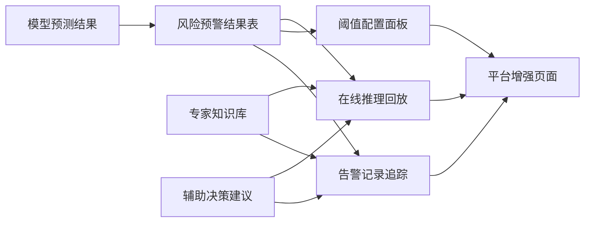
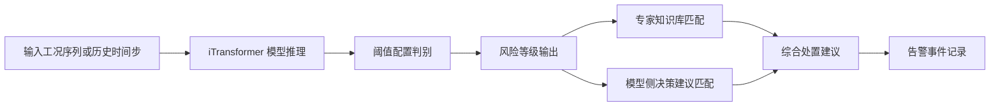

# 平台增强实施方案

## 1. 增强目标

围绕竞赛题目中“平台增强”的要求，当前项目新增并明确了 4 个可展示能力：

1. 在线推理
2. 阈值配置
3. 专家知识库
4. 告警记录追踪

这一步的目标不是单纯补充一个页面，而是把已有的模型预测、风险预警和辅助决策结果，进一步封装成一个更完整的“平台闭环”。

## 2. 当前落地方式

当前版本已经在 Streamlit 平台中新增“平台增强”模块，采用“历史回放 + 规则联动”的方式实现答辩可演示原型：

- 在线推理：基于历史时间步回放当前最优模型的预测结果，展示预测值、误差、风险等级和处置建议。
- 阈值配置：读取默认阈值，并允许通过界面滑块调整 warning / danger 阈值，实时预览风险分布变化。
- 专家知识库：引入结构化规则表，补充模型规则之外的工艺专家知识。
- 告警记录追踪：将告警事件、风险等级、推荐动作和关键变量关联起来，形成可追踪的事件视图。

## 3. 模块结构



## 4. 数据与文件映射

- 专家知识库文件：
  [expert_knowledge_base.csv](C:/Users/lenovo/Desktop/人工智能大赛/data/external/expert_knowledge_base.csv)
- 阈值配置文件：
  [thresholds.json](C:/Users/lenovo/Desktop/人工智能大赛/config/thresholds.json)
- 告警历史文件：
  [alert_history.csv](C:/Users/lenovo/Desktop/人工智能大赛/data/alerts/alert_history.csv)
- 平台增强服务：
  [platform_enhancement.py](C:/Users/lenovo/Desktop/人工智能大赛/src/app/services/platform_enhancement.py)
- 在线推理模块：
  [predictor.py](C:/Users/lenovo/Desktop/人工智能大赛/src/inference/predictor.py)
- 阈值管理模块：
  [threshold_config.py](C:/Users/lenovo/Desktop/人工智能大赛/src/config/threshold_config.py)
- 专家规则模块：
  [expert_rules.py](C:/Users/lenovo/Desktop/人工智能大赛/src/knowledge/expert_rules.py)
- 告警记录模块：
  [alert_logger.py](C:/Users/lenovo/Desktop/人工智能大赛/src/alerts/alert_logger.py)
- 可视化主页面：
  [main.py](C:/Users/lenovo/Desktop/人工智能大赛/src/app/main.py)

## 5. 页面展示内容

### 5.1 在线推理

- 选择目标变量和时间步
- 展示预测值、真实值、绝对误差、风险等级
- 展示“输入 -> 模型推理 -> 阈值判别 -> 决策输出”的推理链路
- 联动模型侧建议与专家规则命中
- 支持加载 `outputs/models/itransformer_model.pt`，使用最新 12 行工况序列执行模型权重推理
- 推理结果自动进入阈值判别和专家知识库匹配链路

### 5.2 阈值配置

- 展示当前系统默认阈值
- 支持自定义 warning / danger 的值阈值与误差阈值
- 预览自定义阈值下 normal / warning / danger 的数量变化

### 5.3 专家知识库

- 结构化存储规则编号、关注对象、触发模式、检查项、推荐动作
- 支持按目标变量和风险等级筛选
- 作为后续更复杂工艺规则的扩展入口

### 5.4 告警记录追踪

- 支持按目标、风险等级、关键词过滤
- 展示事件时间线
- 展示告警记录与处置建议明细

## 6. 对答辩展示的价值

加入“平台增强”后，项目不再只是“做了模型和图”，而是更接近一个完整的工业智能平台：

- 能展示模型结果如何进入平台
- 能展示告警阈值如何配置
- 能展示专家经验如何融入系统
- 能展示告警发生后如何形成可追踪的处理闭环

## 7. 后续可继续完善的方向

1. 将在线推理从历史回放升级为实时接口推理
2. 将阈值配置持久化到配置文件或数据库
3. 扩展专家知识库为 YAML / JSON 规则引擎
4. 增加告警确认、处置状态、责任人和备注字段
5. 增加导出 PDF / CSV 的答辩材料能力

## 8. 模型推理与专家知识库接入

当前版本已经补充统一推理服务：

- [inference_service.py](C:/Users/lenovo/Desktop/人工智能大赛/src/inference/inference_service.py)

该服务把原本分散的模型推理、阈值判断、专家规则匹配和推荐输出整合为一次调用：



当前支持两种推理方式：

- 历史回放推理：读取 `itransformer_predictions.joblib` 中的测试集预测结果，用于展示预测值、真实值和误差。
- 最新序列推理：加载 `itransformer_model.pt`，对最新 12 行 SRU 工况序列进行模型前向推理，用于模拟实时在线推理。

统一推理结果包含：

- `prediction`：模型预测值、目标变量、时间步或在线序列标识
- `threshold`：值风险、误差风险、总风险等级和阈值来源
- `expert_rules`：命中的专家知识规则
- `model_recommendations`：匹配的模型侧辅助决策建议
- `recommendation`：综合处置建议
- `alert_event`：可写入告警历史的事件记录

## 9. 当前代码结构建议

```text
src/
├── app/
│   ├── main.py
│   └── services/
│       └── platform_enhancement.py
├── inference/
│   ├── predictor.py
│   └── inference_service.py
├── config/
│   └── threshold_config.py
├── knowledge/
│   └── expert_rules.py
├── alerts/
│   └── alert_logger.py
```

各模块职责如下：

- `predictor.py`：负责读取当前最优模型预测产物，支撑在线推理回放与批量推理展示
- `threshold_config.py`：负责阈值配置的读取、生成与保存
- `expert_rules.py`：负责专家知识库规则的查询与过滤
- `alert_logger.py`：负责告警事件落表、查询与后续闭环追踪
