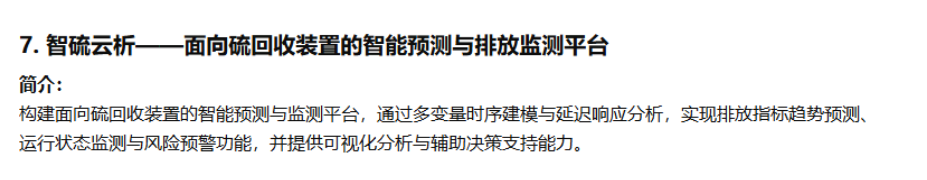
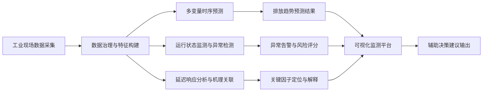
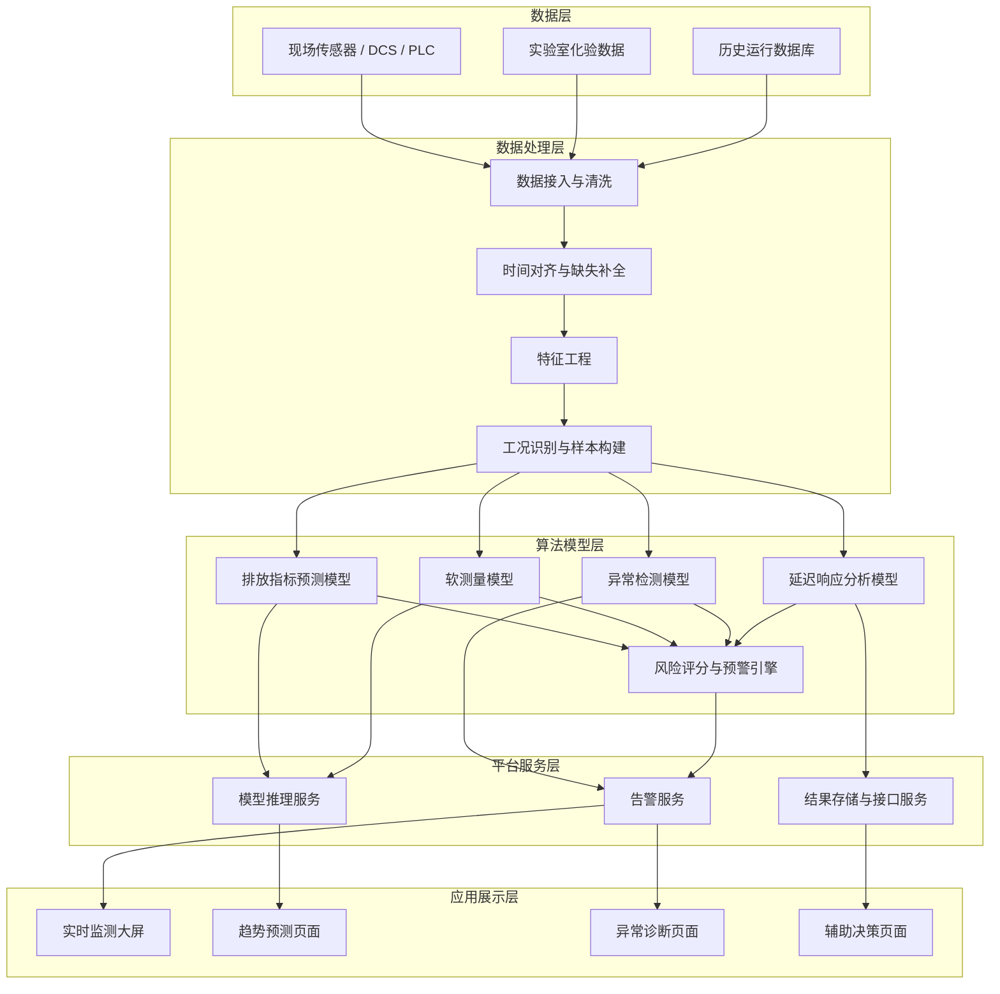

# 智碳云析——面向硫回收装置的智能预测与排放监测平台

## 1. 赛题图片

## 2. 赛题简介

本项目面向研究生人工智能创新大赛赛题“智碳云析——面向硫回收装置的智能预测与排放监测平台”展开方案设计。

赛题核心要求是构建一个面向硫回收装置的智能预测与监测平台，通过多变量时序建模与延迟响应分析，实现排放指标趋势预测、运行状态监测与风险预警，并提供可视化分析与辅助决策支持能力。

## 3. 项目总体定位

项目名称建议沿用：

**智碳云析——面向硫回收装置的智能预测与排放监测平台**

项目总体目标聚焦于以下四个方面：

1. 对 `SO2`、`H2S` 及关键排放指标进行短时趋势预测。
2. 对硫回收装置运行状态进行异常检测与风险预警。
3. 对工艺变量与排放指标之间的延迟响应关系进行建模与分析。
4. 构建可视化监测与辅助决策平台，提升工业应用价值。

## 4. 建设目标

围绕硫回收装置的运行监测和排放控制需求，项目拟建设一个集“感知、分析、预警、决策”于一体的智能平台，形成如下能力：

- 实时采集并管理装置运行数据、排放数据和实验室分析数据。
- 基于多变量时序模型预测未来一段时间内的关键排放趋势。
- 利用异常检测模型识别设备异常、工况偏离和排放超标风险。
- 通过延迟响应分析定位影响排放变化的关键工艺变量。
- 以图形化方式展示监测、预测、告警和决策建议结果。

## 5. 技术路线图

### 5.1 技术路线说明

1. `工业现场数据采集`
   从 DCS、PLC、在线传感器、历史数据库和实验室检测环节采集温度、压力、流量、组分、阀位、尾气指标等数据。

2. `数据治理与特征构建`
   对多源数据进行时间对齐、缺失补全、异常值处理、归一化、滑动窗口切片和工况标签划分。

3. `多变量时序预测`
   构建面向排放指标的短时预测模型，对未来 `15/30/60` 分钟内的 `SO2`、`H2S` 等指标进行趋势预测。

4. `运行状态监测与异常检测`
   识别运行异常、设备工况偏离和潜在排放超标风险，实现告警和风险评分。

5. `延迟响应分析与机理关联`
   分析关键工艺变量对排放指标的滞后影响关系，为根因定位和辅助决策提供支持。

6. `可视化平台与辅助决策`
   将预测结果、异常检测结果和关键因子解释结果统一呈现在监测平台中，并输出可执行的运行建议。

## 6. 系统架构图

## 7. 系统功能模块规划

### 7.1 实时监测模块

- 展示当前工况和关键工艺参数。
- 展示当前排放状态和设备运行状态。
- 通过图表和告警灯反映系统健康度。

### 7.2 趋势预测模块

- 对未来 `15/30/60` 分钟排放指标进行预测。
- 支持展示历史真实值与未来预测值对比曲线。
- 支持展示置信区间和预测波动范围。

### 7.3 异常预警模块

- 输出异常分数和风险等级。
- 对潜在排放超标事件进行提前预警。
- 支持历史告警记录查询与追踪。

### 7.4 诊断分析模块

- 分析异常变量的贡献度和排序。
- 展示关键变量对排放指标的延迟影响关系。
- 支持故障根因定位和运行偏差识别。

### 7.5 辅助决策模块

- 根据模型结果生成运行建议。
- 提示可能需要重点检查的工艺变量和设备环节。
- 为操作人员提供可解释的调控参考。

## 8. 模型与算法规划

### 8.1 基线模型

为保证方案的可实现性和实验可对比性，建议先建立基础模型：

- `XGBoost`
- `LSTM`

### 8.2 主模型方向

在基线模型基础上，进一步引入更适合多变量长序列建模的时序模型：

- `iTransformer`
- `TimesNet`
- `PatchTST`

### 8.3 异常检测模型

针对工业场景下的异常状态监测，可考虑如下模型：

- `OmniAnomaly`
- `Merlion`
- `MTAD-GAT`

### 8.4 软测量与少标签场景

考虑到工业现场部分质量指标采样频率低、标签稀缺，可引入半监督软测量方法：

- `半监督 VAE`
- `LSTM 软测量模型`

### 8.5 可解释分析方法

为增强答辩表现和工业可用性，建议补充解释分析模块：

- `SHAP`
- 延迟相关分析
- 注意力权重可视化

## 9. 项目创新点设计

建议将本项目创新点概括为以下几个方面：

1. 面向硫回收装置这一特定工业场景，突出行业针对性。
2. 将排放趋势预测、异常检测和风险预警进行一体化融合。
3. 引入延迟响应分析，揭示工艺变量对排放指标的滞后影响机制。
4. 引入不确定性估计与风险评分，提升预警可信度。
5. 提供可解释分析和辅助决策建议，增强落地应用价值。
6. 支持多工况识别与分场景建模，提高复杂工况下的鲁棒性。

## 10. 实施路线图

### 第一阶段：需求分析与数据准备

- 明确输入变量、预测目标和评价指标。
- 确定数据采样周期、时间粒度和标签定义。
- 完成数据清洗、时间对齐和缺失补全。

### 第二阶段：基线模型建立

- 建立 `XGBoost` 和 `LSTM` 基线模型。
- 完成基础预测实验和误差评估。
- 形成初步结果，为后续优化提供基准。

### 第三阶段：高级模型与异常检测

- 引入 `Transformer` 类模型进行预测增强。
- 引入异常检测模型进行风险识别。
- 对不同模型进行效果对比和参数优化。

### 第四阶段：延迟响应与解释分析

- 构建关键变量滞后影响分析方法。
- 实现关键因子贡献排序与异常定位。
- 增强模型结果的可解释性。

### 第五阶段：平台集成与可视化展示

- 搭建前端展示页面与后端推理服务。
- 实现监测、预测、预警和诊断模块联动。
- 完成演示系统集成与功能联调。

### 第六阶段：测试优化与答辩准备

- 完成系统测试、误差分析和性能优化。
- 整理典型案例、系统截图和实验结果。
- 完成申报书、PPT 和答辩材料准备。

## 11. 团队分工建议

可按照以下方向进行分工：

- 1 人负责数据处理与特征工程。
- 1 人负责预测模型设计与实验对比。
- 1 人负责异常检测与解释分析。
- 1 人负责平台开发与可视化展示。
- 1 人负责文档撰写、PPT 制作与答辩整合。

## 12. 预期成果

项目预期形成以下成果：

- 一套面向硫回收装置的智能预测与排放监测原型平台。
- 一套排放趋势预测、异常预警和延迟响应分析算法流程。
- 一组可视化监测页面与辅助决策展示结果。
- 一份完整的技术方案、实验报告和答辩材料。

## 13. 后续可继续完善的内容

在当前初步方案基础上，后续还可以继续补充：

- 详细的数据字段表和变量说明。
- 更具体的评价指标体系，如 `MAE`、`RMSE`、`R2`、告警准确率等。
- 项目甘特图与进度安排。
- 申报书正式版内容。
- PPT 提纲和答辩讲稿。
